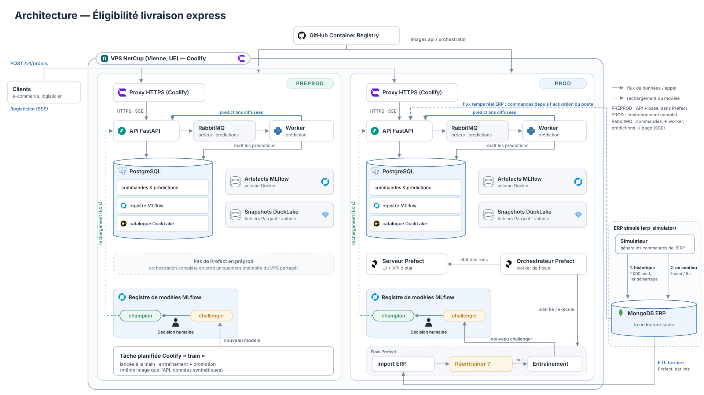

# ADR-0003 : Choix de la plateforme de déploiement

- Status: Accepted
- Date: 2026-10-09
- Deciders: Romain
- Tags: `infra`

## Context

L'application (API FastAPI de prédiction, worker de traitement des commandes, entraînement du modèle) doit être déployée en production sur un VPS déjà partagé avec d'autres projets : 4 vCPU, 8 Go de RAM, 256 Go de disque (démarrage sur HDD), architecture AMD64. Le développement se fait sur un MacBook Pro M1 (arm64), donc les images de production doivent être construites pour `linux/amd64`.

Contraintes : Docker est obligatoire ; Kubernetes est facultatif mais intéressant pour la pédagogie ; une seule instance avec redémarrage automatique suffit ; le projet doit consommer le moins de ressources possible pour ne pas pénaliser les autres projets. Coolify est déjà installé sur le VPS et gère les autres projets. Il est connecté au compte GitHub `Romain-Data`.

Besoins fonctionnels côté exécution : une base PostgreSQL pour les commandes (ADR-0001) et pour le registre de modèles (ADR-0002), un volume persistant pour les artefacts de modèles, et la possibilité de lancer l'entraînement en production comme tâche ponctuelle.

## Decision

Nous déployons sur le VPS avec Coolify, qui orchestre des conteneurs Docker, sans installer d'orchestrateur supplémentaire (pas de Kubernetes sur le VPS).

- **Application** : une image Docker unique, construite pour `linux/amd64` à partir d'un `Dockerfile` du dépôt, contenant l'API et le code d'entraînement. Coolify l'exécute en une seule instance, avec redémarrage automatique, des limites de mémoire et de CPU, et un health check sur `/health/ready`. Le HTTPS et le routage sont assurés par le proxy de Coolify.
- **Base de données** : un conteneur PostgreSQL dédié à ce projet, géré par Coolify, avec des bases distinctes pour les commandes et pour le registre MLflow (et, le cas échéant, pour le catalogue DuckLake). Les sauvegardes sont planifiées dans Coolify.
- **Artefacts** : un volume persistant Coolify monté dans le conteneur de l'application, pour la racine des artefacts MLflow (`MLFLOW_ARTIFACT_ROOT`).
- **Entraînement** : une tâche ponctuelle qui lance `python -m src.training.pipeline` à partir de la même image, avec les mêmes variables d'environnement et le même volume que l'API. Elle ne tourne pas en permanence.
- **Configuration** : toute la configuration passe par des variables d'environnement définies dans Coolify (`DATABASE_URL`, `MLFLOW_TRACKING_URI`, `MLFLOW_ARTIFACT_ROOT`).
- **Kubernetes** : il se pratique en local (par exemple avec `kind`), avec la même image. Il n'est pas installé sur le VPS.

Cette décision porte sur la plateforme d'exécution uniquement. Le déclenchement des déploiements (à chaque push, sur tag, manuel, par CI) n'est pas fixé ici : il fait l'objet de l'ADR-0004. L'image et la configuration restent indépendantes de Coolify pour ne pas verrouiller ce choix.

### Schéma des composants

Deux environnements identiques (preprod, prod) sur le même VPS, chacun avec son API (et son worker), sa base PostgreSQL (commandes et prédictions, registre MLflow, catalogue DuckLake), ses volumes et son orchestration Prefect. Les images viennent de GitHub Container Registry ; l'ERP (MongoDB) est lu en lecture seule par l'ETL horaire.

### Justification

- **Coolify déjà en place** : le coût du plan de contrôle est déjà payé. Il fournit HTTPS, variables d'environnement, volumes, health checks, redémarrage, limites de ressources et sauvegardes de base, donc rien à réécrire.
- **Pas d'orchestrateur sur le VPS** : k3s ferait doublon avec Coolify sur une machine partagée, pour un gain uniquement pédagogique ; une seule instance ne justifie pas Kubernetes.
- **Image unique** : API, worker et entraînement partagent le même code et les mêmes dépendances. Une seule image à construire, tester et versionner, et l'entraînement en production utilise exactement ce qui est servi.
- **Base dédiée** : isole le projet des autres, permet des sauvegardes et des mises à jour indépendantes ; le surcoût en mémoire est accepté.
- **Limites de ressources** : plafonner la mémoire et le CPU protège les autres projets du VPS.
- **Dépendance de l'image à Docker et non à Coolify** : l'image tourne ailleurs (Docker, Kubernetes local) sans modification, ce qui garde le choix du mode de déploiement ouvert.

## Consequences

**Positives**
- Déploiement simple et peu coûteux en ressources, cohérent avec les autres projets du VPS.
- HTTPS, redémarrage, sauvegardes de base et gestion des secrets fournis par la plateforme.
- La même image sert en développement local, en test, en production et en Kubernetes local.
- Les sauvegardes planifiées de Coolify réduisent le risque de perte des artefacts noté dans l'ADR-0002 (à configurer sur le volume et sur la base).

**Négatives**
- Dépendance opérationnelle à Coolify et à son instance sur le VPS ; si Coolify est indisponible, on ne déploie plus, même si les conteneurs en cours continuent de tourner.
- Une seule instance : pas de haute disponibilité, un redémarrage ou un déploiement entraîne une courte interruption.
- Un PostgreSQL de plus à exploiter, qui consomme de la mémoire sur un VPS partagé, avec un disque de démarrage en HDD, lent pour les écritures.
- L'API charge le modèle `champion` au démarrage (ADR-0002) : après un entraînement qui change le champion, il faut redémarrer l'API ou prévoir un rechargement.
- L'entraînement dans l'image de l'application alourdit l'image et sa consommation de mémoire pendant la tâche (scikit-learn, MLflow) ; la limite de mémoire doit en tenir compte.
- Le driver PostgreSQL (par exemple `psycopg`) n'est pas encore dans les dépendances du projet et doit être ajouté.
- Le dev est en arm64 et la prod en amd64 : une image construite sur le Mac sans cible explicite ne tournerait pas sur le VPS.

**Neutres**
- Le mécanisme exact de la tâche d'entraînement (tâche planifiée Coolify, commande dans le conteneur, second conteneur à partir de la même image) est à choisir à l'implémentation ; il dépend des fonctions de la version de Coolify installée.
- La pédagogie Kubernetes reste partielle : les manifestes se testent en local, pas sur le VPS.
- Si le projet grossit (plusieurs instances, mise à l'échelle), la plateforme sera à reconsidérer.

**Mesures d'atténuation**
- Construire l'image avec `--platform linux/amd64` (ou en CI) et vérifier son démarrage avant le déploiement.
- Définir des limites de mémoire et de CPU, et mesurer la consommation pendant un entraînement avant de les figer.
- Activer les sauvegardes planifiées de la base et du volume, avec stockage hors du VPS, et tester une restauration.
- Garder dans le dépôt un `Dockerfile` et une configuration ne dépendant que de variables d'environnement.
- Traiter le rechargement du modèle après entraînement dans l'ADR-0004 ou dans une évolution du service.

## Mise à jour (2026-11-17) : deux images, deux environnements Compose

- **Deux images au lieu d'une** : la même base, deux cibles Docker. `api` (API, worker, entraînement, ETL) reste minimale ; `orchestrator` y ajoute Prefect pour exécuter les flows planifiés (ADR-0009). Toutes deux sont construites une seule fois par la CI et promues telles quelles en prod (ADR-0004).
- **`docker-compose.test.yml`** : toute la chaîne construite depuis les sources, ERP simulé compris (repris du compose de l'ERP par `include`) ; un service `migrate` crée les bases et applique les migrations une seule fois avant l'API et l'orchestrateur, ce qui évite qu'ils le fassent en même temps.
- **`docker-compose.prod.yml`** : images publiées (`APP_VERSION`), ERP externe (`ERP_MONGO_URI`), secrets obligatoires sans valeur par défaut, limites de ressources (API 1 Go, orchestrateur 1,5 Go, Prefect 512 Mo, PostgreSQL 256 Mo), redémarrage automatique, ports publiés seulement en local. Mesuré le 2026-11-17 avec les images 0.2.0 : environ 1 Go utilisé au total après un entraînement.
- **Coolify** : le compose de prod décrit la cible ; son déploiement sur le VPS (serveur Prefect et orchestrateur à côté des applications existantes) est l'étape suivante.

## Alternatives considered

- **Docker Compose géré à la main** : respecte Docker, mais recrée HTTPS, déploiement et supervision que Coolify fournit déjà ; écarté.
- **k3s (Kubernetes léger) sur le VPS** : bon pour la pédagogie, mais double Coolify, ajoute un plan de contrôle d'environ un demi à un gigaoctet de mémoire sur une machine partagée, pour une seule instance ; écarté, Kubernetes se pratique en local.
- **Docker Swarm** : peu d'intérêt pour une seule instance et peu utilisé aujourd'hui ; écarté.
- **PaaS externe (Fly.io, Render, etc.)** : sort du cadre du VPS et ajoute un fournisseur ; écarté.
- **Podman avec systemd** : équivalent à Docker Compose en effort, alors que Docker est imposé ; écarté.
- **PostgreSQL partagé avec d'autres projets** : économise de la mémoire, mais couple les projets (mises à jour, charge, sauvegardes) ; écarté au profit d'une base dédiée.
- **Entraînement hors production, seulement sur le Mac** : plus léger pour le VPS, mais contraire à l'exigence de pouvoir entraîner en production ; écarté.

## Links

- Related ADRs : [[ADR-0001 - Stockage des commandes]], [[ADR-0002 - Stockage des artefacts de modele]], [[ADR-0004 - Stratégie de déploiement]]
- External references :
  - [Coolify](https://coolify.io/docs)
