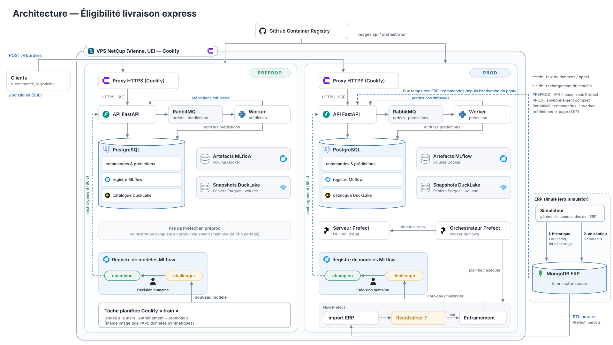
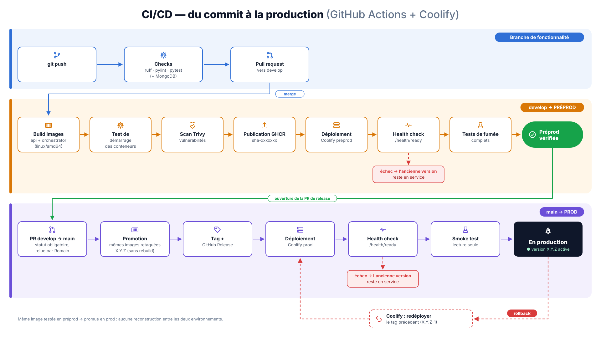

# Éligibilité à la livraison express

[](https://github.com/Romain-Data/Industrialisation_IA_dans_cloud/actions/workflows/ci.yml)
[](LICENSE)

API qui prédit si une commande peut partir en **livraison express**, à partir de ses caractéristiques (distance, poids, stock, météo, zone, etc.).

Ce dépôt est l'industrialisation d'un POC (notebook de régression logistique) : API, file de traitement, registre de modèles, entraînement reproductible, image Docker, CI/CD et déploiement sur un VPS avec Coolify. Il est réalisé dans le cadre du module « Industrialisation de l'IA dans le cloud ».

| Environnement | URL | Déployé depuis |
|---|---|---|
| Preprod | https://express-delivery-preprod.romaincollery.com | branche `develop` |
| Prod | https://express-delivery.romaincollery.com | GitHub Release `vX.Y.Z` |

Documentation interactive de l'API : `/docs` sur chaque environnement.

## Sommaire

- [Fonctionnement](#fonctionnement)
- [Page du logisticien (temps réel)](#page-du-logisticien-temps-réel)
- [API](#api)
- [Démarrage rapide](#démarrage-rapide)
- [Entraînement du modèle](#entraînement-du-modèle)
- [Configuration](#configuration)
- [Tests et qualité](#tests-et-qualité)
- [Déploiement](#déploiement)
- [Structure du dépôt](#structure-du-dépôt)
- [Décisions d'architecture](#décisions-darchitecture)
- [Contribuer](#contribuer)

## Fonctionnement



Flux d'une commande :

```text
                    POST /v1/orders                       file (en mémoire)
 client ──────────────────────────────────▶ API FastAPI ───────────────────▶ worker
   │                                           │                                │ prédiction
   │  GET /v1/predictions/{id}                 ▼                                ▼
   └─────────────────────────────────▶  PostgreSQL : commandes, prédictions ◀───┘
                                               │
   PUT /v1/orders/{id}/outcome (résultat réel) │ export des commandes étiquetées
                                               ▼
                       DuckLake (snapshots Parquet versionnés) ──▶ entraînement ──▶ MLflow
                                                                                     │
                                L'API charge le modèle portant l'alias `champion` ◀──┘
```

- **Commandes** : stockées dans une base transactionnelle (SQLite en dev, PostgreSQL en prod) via SQLAlchemy, schéma versionné avec Alembic.
- **Prédictions** : calculées de façon asynchrone par un worker, ou de façon synchrone avec `POST /v1/predictions`.
- **Résultat réel** : une fois la livraison faite, `PUT /v1/orders/{id}/outcome` enregistre si elle a pu partir en express. C'est la cible d'entraînement.
- **Entraînement** : les commandes étiquetées sont figées dans un snapshot DuckLake, ce qui rend chaque entraînement reproductible. Le modèle est enregistré dans MLflow et ne devient `champion` que si son ROC AUC est meilleur que celui du champion actuel.

## Page du logisticien (temps réel)

[`/logisticien`](https://express-delivery.romaincollery.com/logisticien) affiche chaque prédiction dès qu'elle est calculée. Les commandes **éligibles à l'express** sont mises en évidence et notifiées (bannière, et notification du navigateur si on l'autorise). Le parcours ([ADR-0013](IndusIAdansCloud/ADR/ADR-0013%20-%20RabbitMQ%20et%20interface%20temps%20r%C3%A9el%20du%20logisticien.md)) :

```text
POST /v1/orders ─▶ PostgreSQL ─▶ RabbitMQ (file orders) ─▶ worker : prédiction
   worker ─▶ RabbitMQ (échange predictions) ─▶ API ─SSE─▶ navigateur du logisticien
```

Pour la démonstration, le bouton **Générer 5 commandes** (`DEMO_MODE=true`) crée des commandes fictives (`DEMO-…`) qui suivent exactement ce parcours. Sans `RABBITMQ_URL` (développement, tests), la file et la diffusion restent en mémoire.

## API

Le contrat de l'API est [`openapi.yml`](openapi.yml) ; les tests vérifient que l'implémentation le respecte.

| Méthode | Route | Rôle |
|---|---|---|
| `GET` | `/health` | Le service répond |
| `GET` | `/health/ready` | Modèle chargé, base joignable, schéma à jour, file joignable, worker actif (503 sinon) |
| `POST` | `/v1/orders` | Enregistrer une commande ; sa prédiction est calculée en arrière-plan (202) |
| `GET` | `/v1/orders/{order_id}` | Relire une commande |
| `PUT` | `/v1/orders/{order_id}/outcome` | Enregistrer le résultat réel d'une commande |
| `POST` | `/v1/predictions` | Prédire immédiatement l'éligibilité d'une commande |
| `GET` | `/v1/predictions/{order_id}` | Relire la prédiction d'une commande |
| `GET` | `/v1/predictions?limit=20` | Dernières prédictions, de la plus récente à la plus ancienne |
| `GET` | `/v1/events/predictions` | Flux temps réel des prédictions (Server-Sent Events) |
| `POST` | `/v1/demo/orders` | Générer des commandes de démonstration (si `DEMO_MODE`, 1 appel / 5 s) |
| `GET` | `/v1/model` | Model card du modèle en service (métriques, variables, limites) |

Exemple :

```bash
curl -X POST https://express-delivery-preprod.romaincollery.com/v1/predictions \
  -H "Content-Type: application/json" \
  -d '{"hour": 14, "day_of_week": 2, "weekend": 0, "distance_km": 3.5,
       "order_value_eur": 89.9, "weight_kg": 2.4, "stock_available": 1,
       "preparation_time_min": 18, "carrier_capacity": 34.5,
       "weather": "clear", "delivery_zone": "centre", "customer_type": "business"}'
```

```json
{"order_id": "CMD-1a2b3c4d", "express_eligible": true, "decision": "oui",
 "probability": 0.9377, "model_version": "2.0.0", "predicted_at": "...", "latency_ms": 24.2}
```

## Démarrage rapide

### Avec Docker Compose (recommandé)

Prérequis : Docker. Deux environnements, chacun dans son fichier :

| Fichier | Contenu | Usage |
|---|---|---|
| [`docker-compose.test.yml`](docker-compose.test.yml) | Toute la chaîne construite depuis les sources : **ERP simulé** (PostgreSQL + MongoDB), notre PostgreSQL, API, serveur Prefect et orchestrateur | Tester l'ensemble sur une machine |
| [`docker-compose.prod.yml`](docker-compose.prod.yml) | Images **publiées** par la CI (`APP_VERSION`), branchées sur l'ERP de l'entreprise (`ERP_MONGO_URI`), sans simulateur ; limites de ressources, redémarrage automatique | Exploiter une version publiée |

Aucun mot de passe n'est écrit dans le dépôt : ils sont obligatoires.

```bash
export POSTGRES_PASSWORD=$(openssl rand -hex 16) ERP_POSTGRES_PASSWORD=$(openssl rand -hex 16)
docker compose -f docker-compose.test.yml up -d --build
```

La stack s'amorce seule : le flow Prefect (toutes les 2 minutes en test) importe les commandes de l'ERP et entraîne le modèle, puis l'API le charge sans redémarrer (2 à 3 minutes au premier démarrage). API : http://127.0.0.1:8000/docs ; Prefect : http://127.0.0.1:4200. `docker compose -f docker-compose.test.yml down -v` arrête tout et efface les données.

```bash
# Prod : version publiée, ERP externe, secrets fournis par l'environnement (.env non commité)
APP_VERSION=0.2.0 POSTGRES_PASSWORD=... ERP_MONGO_URI=mongodb://... docker compose -f docker-compose.prod.yml up -d
```

### En local avec uv

Prérequis : Python 3.12 et [uv](https://docs.astral.sh/uv/).

```bash
uv sync                                     # dépendances, dont les outils de dev
uv run alembic upgrade head                 # schéma de la base SQLite (orders.db)
uv run python -m src.training.pipeline      # entraînement -> mlflow.db + mlartifacts/
uv run uvicorn src.serving.api:app --reload # API sur http://localhost:8000
```

Interface MLflow (runs, métriques, versions du modèle) :

```bash
uv run mlflow ui --backend-store-uri sqlite:///mlflow.db
# avec Docker Compose :
PGPASSWORD=express uv run mlflow ui --backend-store-uri postgresql+psycopg://express@localhost:5433/mlflow
```

## Entraînement du modèle

La source des données est choisie par `TRAINING_SOURCE` :

| Valeur | Données |
|---|---|
| `synthetic` (défaut) | Générateur de commandes synthétiques (`src/infrastructure/dev/collect.py`) |
| `ducklake` | Commandes réelles avec résultat connu, figées dans un nouveau snapshot DuckLake (au moins 50) |

```bash
TRAINING_SOURCE=ducklake uv run python -m src.training.pipeline
```

Chaque run MLflow enregistre ses métriques, la liste des variables et la provenance des données (numéro de snapshot DuckLake). L'API charge le champion **au démarrage** : il faut la redémarrer après un entraînement qui le change. Pour revenir à un modèle précédent, il suffit de replacer l'alias `champion` sur une version antérieure dans MLflow, puis de redémarrer l'API.

## Import des commandes de l'ERP

L'ERP de l'entreprise est simulé par [`erp_simulator/`](erp_simulator/) (PostgreSQL de production et MongoDB analytique). Nous lisons **MongoDB en lecture seule** ([ADR-0007](IndusIAdansCloud/ADR/ADR-0007%20-%20PostgreSQL%2C%20MongoDB%20ou%20autre.md)) par un ETL incrémental et idempotent :

```bash
docker compose -f erp_simulator/docker-compose.erp.yml up -d --build   # ERP simulé
ERP_MONGO_URI=mongodb://localhost:27017 uv run python -m src.etl.erp_import
TRAINING_SOURCE=ducklake uv run python -m src.training.pipeline         # entraînement sur ces données
```

Chaque commande est nettoyée puis validée ; les commandes invalides sont rejetées et comptées. Chaque import est consigné dans la table `erp_imports` (position de reprise et compteurs).

## Orchestration (Prefect)

Le flow `erp-pipeline` ([ADR-0009](IndusIAdansCloud/ADR/ADR-0009%20-%20Orchestration%20du%20r%C3%A9entra%C3%AEnement.md)) tourne toutes les heures : import ERP, puis réentraînement si au moins `RETRAIN_MIN_NEW_ORDERS` nouvelles commandes étiquetées sont arrivées. L'API recharge d'elle-même un nouveau champion (vérification chaque minute), sans redémarrage.

Promotion d'un nouveau modèle ([ADR-0010](IndusIAdansCloud/ADR/ADR-0010%20-%20Garde-fous%20m%C3%A9tier%20et%20contr%C3%B4le%20humain%20de%20la%20promotion.md)) : le candidat et le champion sont notés sur le même jeu d'évaluation. Un candidat meilleur devient champion s'il respecte les garde-fous métier (précision ≥ 0,85, aucun segment dégradé, part d'éligibles stable) ; sinon il reçoit l'alias `challenger` et attend une décision humaine :

```bash
python -m src.training.promote               # valider le challenger
python -m src.training.promote --version 3   # rollback vers la version 3
```

```bash
uv run prefect server start                                   # interface sur http://127.0.0.1:4200
PREFECT_API_URL=http://127.0.0.1:4200/api uv run python -m src.orchestration.serve
```

En Docker, l'orchestrateur est une image à part (`--target orchestrator`) : l'image de l'API ne contient pas Prefect.

Sur le VPS, Prefect tourne **en prod seulement**, avec l'ERP simulé du cours (MongoDB) comme source de l'import. La préprod s'entraîne par la tâche planifiée Coolify `train`. L'interface n'est pas exposée sur Internet ; on y accède par tunnel SSH :

```bash
ssh -N -L 4200:127.0.0.1:4200 <utilisateur>@<vps>   # puis http://localhost:4200
```

## Configuration

Toute la configuration passe par des variables d'environnement ([`src/config.py`](src/config.py)).

| Variable | Défaut (dev) | Rôle |
|---|---|---|
| `DATABASE_URL` | `sqlite:///orders.db` | Base des commandes et prédictions |
| `MLFLOW_TRACKING_URI` | `sqlite:///mlflow.db` | Registre de modèles MLflow |
| `MLFLOW_ARTIFACT_ROOT` | `./mlartifacts` | Fichiers des modèles |
| `DUCKLAKE_CATALOG_URL` | `sqlite:///ducklake.sqlite` | Catalogue des snapshots d'entraînement |
| `DUCKLAKE_DATA_PATH` | `ducklake_data/` | Fichiers Parquet des snapshots |
| `TRAINING_SOURCE` | `synthetic` | Source de l'entraînement (`synthetic` ou `ducklake`) |
| `ERP_MONGO_URI` | `mongodb://localhost:27017` | Base analytique MongoDB de l'ERP, lue en lecture seule (ADR-0007) |
| `ERP_MONGO_DATABASE` / `ERP_MONGO_COLLECTION` | `livraison_express` / `orders` | Base et collection des commandes ERP |
| `ERP_IMPORT_BATCH_SIZE` | `1000` | Taille des lots lus par l'ETL ERP |
| `ERP_PIPELINE_CRON` | `0 * * * *` | Planification du flow Prefect `erp-pipeline` |
| `RETRAIN_MIN_NEW_ORDERS` | `500` | Nouvelles commandes étiquetées nécessaires pour réentraîner |
| `MODEL_RELOAD_INTERVAL_SECONDS` | `60` | Vérification du champion par l'API (0 : désactivée) |
| `PREFECT_API_URL` | — | Serveur Prefect utilisé par l'orchestrateur |
| `RABBITMQ_URL` | — (file en mémoire) | Broker RabbitMQ `amqp://utilisateur:mot-de-passe@hôte:5672/%2F`, fourni par l'environnement (ADR-0013) |
| `RABBITMQ_ORDERS_QUEUE` / `RABBITMQ_PREDICTIONS_EXCHANGE` | `orders` / `predictions` | File des commandes et échange de diffusion des prédictions |
| `DEMO_MODE` | `false` | Active le bouton « Générer des commandes » de la page du logisticien |
| `PORT` | `8000` | Port de l'API dans le conteneur |

En PostgreSQL, les URL utilisent le driver psycopg 3 : `postgresql+psycopg://utilisateur@hôte:5432/base`. Le mot de passe peut être fourni par la variable standard `PGPASSWORD` plutôt que dans l'URL (c'est ce que font les fichiers docker-compose). Au démarrage, le conteneur crée les bases `mlflow` et `ducklake` si elles n'existent pas, puis applique les migrations.

## Tests et qualité

```bash
uv run pytest           # tests unitaires, d'API, de migrations et d'entraînement
uv run ruff check .     # lint
uv run pylint src       # qualité (score minimal dans pyproject.toml)
```

## Déploiement



Le dépôt suit **GitFlow** (détails dans [CONTRIBUTING.md](CONTRIBUTING.md)). La CI GitHub Actions ([`ci.yml`](.github/workflows/ci.yml)) :

1. à chaque push et pull request : `ruff`, `pylint`, `pytest` (avec un MongoDB de test) ;
2. sur `develop` : construit **une fois** les images `linux/amd64` de l'API et de l'orchestrateur, vérifie qu'elles démarrent, les scanne avec Trivy et les publie sur GHCR (tag `sha-xxxxxxx`) ;
3. déploie en **préprod** avec Coolify, attend le résultat, lance des tests de fumée sur l'URL de préprod ([`scripts/smoke_test.py`](scripts/smoke_test.py)) et pose le statut **« Préprod vérifiée »** sur le commit ;
4. la PR `develop` → `main` exige ce statut ; sa fusion **promeut** les mêmes images (tag `X.Y.Z`, sans reconstruction), crée la GitHub Release, déploie en **prod** et vérifie sa santé.

Pour libérer la mémoire du VPS partagé entre deux sessions, le projet s'éteint et se rallume dans l'ordre des dépendances (bases, puis services, puis applications). Les données restent dans les volumes :

```bash
python scripts/coolify_power.py status            # état de chaque ressource
python scripts/coolify_power.py off all           # tout éteindre (--dry-run pour simuler)
python scripts/coolify_power.py on prod           # rallumer la prod
```

Coolify ne met une nouvelle version en service que si `/health/ready` répond ; sinon l'ancienne reste en place et la CI échoue.

L'image Docker ([`Dockerfile`](Dockerfile)) est construite en deux étapes avec uv, tourne avec un utilisateur non root et sert à la fois l'API (`api`, par défaut), l'entraînement (`train`), l'import de l'ERP (`etl`) et les migrations (`migrate`) ; la cible `orchestrator` ajoute Prefect pour exécuter les flows.

## Structure du dépôt

```text
src/
  domain/          règles métier : variables, nettoyage, validation
  abstraction/     interfaces (stockage des commandes, file, snapshots, collecte)
  infrastructure/  implémentations : SQLAlchemy, DuckLake, migrations, bootstrap
  serving/         API FastAPI, worker, prédiction
  training/        pipeline d'entraînement, registre MLflow
migrations/        migrations Alembic
tests/             tests pytest
IndusIAdansCloud/  notes Obsidian, dont les ADR
openapi.yml        contrat de l'API
```

## Décisions d'architecture

Les choix structurants sont documentés sous forme d'ADR dans [`IndusIAdansCloud/ADR/`](IndusIAdansCloud/ADR/). Nos numéros suivent l'ordre de rédaction ; la table indique quel ADR traite chaque sujet du barème du cours.

| Sujet du barème | ADR du projet | Contenu |
|---|---|---|
| ADR-0001 : Stockage des commandes | [ADR-0001](IndusIAdansCloud/ADR/ADR-0001%20-%20Stockage%20des%20commandes.md) | SQLAlchemy, SQLite / PostgreSQL, Alembic, snapshots DuckLake |
| ADR-0002 : Stockage des artefacts de modèle | [ADR-0002](IndusIAdansCloud/ADR/ADR-0002%20-%20Stockage%20des%20artefacts%20de%20modele.md) | MLflow, registre, alias `champion`, schéma de données |
| ADR-0003 : Quelle plateforme de déploiement ? | [ADR-0003](IndusIAdansCloud/ADR/ADR-0003%20-%20Choix%20de%20la%20plateforme%20de%20d%C3%A9ploiement.md) | Coolify sur VPS, image Docker unique |
| ADR-0004 : Cloud, on-premise ou local ? | [ADR-0008](IndusIAdansCloud/ADR/ADR-0008%20-%20Cloud%2C%20on-premise%20ou%20local.md) | cloud IaaS (VPS NetCup dans l'UE) auto-administré, local pour le développement, cloud managé et on-premise écartés |
| ADR-0005 : Quelle stratégie de déploiement ? | [ADR-0004](IndusIAdansCloud/ADR/ADR-0004%20-%20Strat%C3%A9gie%20de%20d%C3%A9ploiement.md) | Big Bang protégé par health check après validation en preprod, champion / challenger pour le modèle, CI GitHub Actions, GitFlow |
| ADR-0006 : PostgreSQL, MongoDB, autre ? | [ADR-0007](IndusIAdansCloud/ADR/ADR-0007%20-%20PostgreSQL%2C%20MongoDB%20ou%20autre.md) | MongoDB analytique en lecture seule, ETL |
| ADR-0007 : Sécuriser les entrées, sorties et l'accès à la donnée | [ADR-0005](IndusIAdansCloud/ADR/ADR-0005%20-%20S%C3%A9curisation%20des%20entr%C3%A9es%2C%20sorties%20et%20acc%C3%A8s%20%C3%A0%20la%20donn%C3%A9e.md) | secrets, image, CI, dépôt, limites connues |
| *(hors barème)* | [ADR-0009](IndusIAdansCloud/ADR/ADR-0009%20-%20Orchestration%20du%20r%C3%A9entra%C3%AEnement.md) | orchestration Prefect : import ERP horaire, réentraînement, rechargement du modèle |
| *(hors barème)* | [ADR-0006](IndusIAdansCloud/ADR/ADR-0006%20-%20File%20d'attente.md) | file d'attente des commandes en mémoire (remplacée par l'ADR-0013) |
| Temps réel (bonus) | [ADR-0013](IndusIAdansCloud/ADR/ADR-0013%20-%20RabbitMQ%20et%20interface%20temps%20r%C3%A9el%20du%20logisticien.md) | RabbitMQ, flux SSE, page du logisticien, bouton de démonstration |
| *(hors barème)* | [ADR-0010](IndusIAdansCloud/ADR/ADR-0010%20-%20Garde-fous%20m%C3%A9tier%20et%20contr%C3%B4le%20humain%20de%20la%20promotion.md) | garde-fous métier, alias `challenger`, décision humaine, mode shadow (non retenu) |
| Estimation budgétaire | [ADR-0011](IndusIAdansCloud/ADR/ADR-0011%20-%20Estimation%20budg%C3%A9taire.md) | quote-part du VPS NetCup, comparaison cloud managé, coût humain |
| Prise en compte des normes (RGPD) | [ADR-0012](IndusIAdansCloud/ADR/ADR-0012%20-%20Conformit%C3%A9%20RGPD.md) | données pseudonymisées, rôles, minimisation, conservation, hébergement UE |

## Contribuer

Voir [CONTRIBUTING.md](CONTRIBUTING.md). Merci de respecter le [code de conduite](CODE_OF_CONDUCT.md) et de signaler les failles de sécurité selon [SECURITY.md](SECURITY.md).

## Licence

[MIT](LICENSE)
